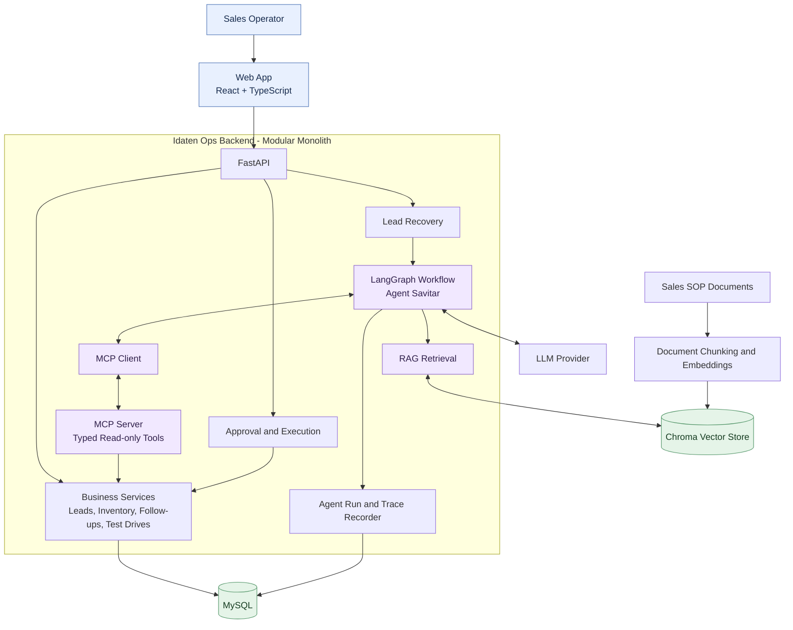
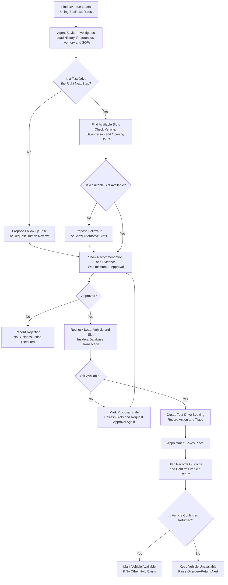

# Idaten Ops

## AI-assisted workflow for pre-owned automotive retail.

**Tagline:** Recover missed leads. Make every next step count.

Idaten Ops is an internal workspace for preowned-car sales teams. It helps staff review overdue buyer enquiries, check vehicle and appointment details, and act on the right follow-up.

Its AI agent, **Agent Savitar**, reads the lead history, checks current business records, looks up the relevant sales procedure, and proposes one specific action:

- **Create a follow-up task** for a salesperson, such as checking whether the buyer wants to consider another vehicle.
- **Propose a test-drive booking** when the buyer has clearly asked for a test drive and a valid vehicle, salesperson, and time slot are available.

A follow-up task is an internal work item assigned to a salesperson. It does not place a call or send a message. An operator must approve an agent proposal before it changes business records. The backend checks the latest data, performs the approved action, and records what happened. Savitar does not contact customers.

This is not a public car marketplace or a full dealership management system. Demo leads, buyers, staff, listings, and bookings are generated sample data. Vehicle specifications may use cited manufacturer sources; sample listing prices and stock status are not live market data.

<!-- ## 1. Main screens

1. **Lead Recovery Dashboard:** Overdue leads, assigned salesperson, lead status, last activity, contact restrictions, pending proposals, and open tasks.
2. **Lead Review:** Buyer preferences and history, vehicle details, related sales-procedure evidence, Savitar's proposed action, and approve/reject controls.
3. **Agent Trace:** The ordered steps Savitar ran, including tool calls, records checked, procedure passages found, decisions, errors, and action results. It shows recorded steps, not hidden model reasoning.
4. **Agent Activity:** Actions and decisions that actually occurred, including approvals, task creation, bookings, cancellations, vehicle checkout/return, and recorded outcomes. Each relevant item links to its agent trace.
5. **Vehicle Inventory:** Search and filter listings, view condition and inspection status, and compare suitable alternatives.
6. **Test Drive Schedule:** Available slots, bookings, assigned salesperson, customer-confirmation record, appointment status, vehicle checkout/return, and overdue alerts. -->

The operator can check inventory and create a booking manually. Agent Savitar uses the same backend rules and records, so its results cannot bypass the rules used by the operator.

## 1. Lead Recovery workflow

1. **Lead selection:** The backend identifies open leads whose follow-up deadlines have passed, using deterministic business rules.
2. **Investigation:** Agent Savitar reviews lead history, recent activity, contact permissions, existing tasks, relevant inventory, and applicable sales procedures.
3. **Recommendation:** The agent proposes an internal follow-up task or a test-drive booking when the recorded evidence supports that action. Each proposal includes its supporting facts and procedure references.
4. **Human decision:** An operator approves or rejects the proposal. No proposed action changes business records before approval.
5. **Validation and execution:** The backend revalidates the approved proposal against current records and executes it only if all required conditions still hold.
6. **Outcome recording:** The workspace displays the action result and its associated trace. Invalid or conflicting proposals are rejected with a clear reason.
7. **Real-world status:** Staff record outcomes that cannot be established by the system alone. A created task does not prove that a call occurred, and a reserved slot does not prove customer notification or confirmation.

## 2. Test-drive booking requirements

Test-drive booking is included in the first release. A booking reserves an internal appointment slot; it does not send customer notifications or create an external calendar event.

### Eligibility and availability

- A test-drive proposal requires recorded inbound activity that clearly establishes the buyer's request. General interest in a vehicle is insufficient.
- The contact-permission status must be `permitted`. The statuses `unknown` and `do_not_contact` prevent the agent from proposing a booking.
- The vehicle must belong to the lead's location, be available, and have passed inspection. Sold, withdrawn, reserved, and review-needed vehicles are ineligible.
- The assigned salesperson must be active, eligible for test drives, and associated with the relevant location.
- The selected slot must be in the future, open, and associated with the same location.
- The demo schedule provides three sample start times per day: 10:00, 13:00, and 16:00 local time. Each appointment lasts 30 minutes, followed by a 15-minute vehicle turnaround buffer. These values are configurable demo settings.
- Availability is validated when slots are displayed and checked again during booking approval. Displayed availability does not guarantee a later reservation.
- Proposed bookings do not reserve slots. A reservation is created only after successful approval and validation. Manual bookings follow the same rules.

### Booking lifecycle and recorded outcomes

- `scheduled`: The internal appointment slot is reserved. Customer confirmation remains `not_recorded` until staff records it.
- `checked_out`: Staff has recorded that the vehicle physically left for the test drive.
- `returned`: Staff has recorded the vehicle's actual return time. The vehicle cannot be released for another test drive until its return is recorded and no other hold applies.
- `completed`: Staff has recorded the test-drive outcome, and the vehicle return has been recorded where checkout occurred.
- `cancelled`: Staff has cancelled the booking before checkout and recorded the reason.
- `no_show`: Staff has explicitly recorded a no-show after the appointment slot has ended. The system never infers a no-show from elapsed time alone.

If a checked-out vehicle passes its expected return time, the schedule displays **Return overdue**. The vehicle remains unavailable until staff records its actual return.

If an appointment slot ends without a recorded outcome, the schedule displays **Appointment outcome unresolved**. This status does not imply a no-show.

## 3. Scope

### Included in the first release

- A local operations workspace with six screens: Lead Recovery Dashboard, Lead Review, Agent Trace, Agent Activity, Vehicle Inventory, and Test Drive Schedule.
- Lead history, overdue-lead recovery, inventory search, internal follow-up tasks, and test-drive booking.
- Human approval for every action proposed by Agent Savitar.
- Trace records, activity history, and audit records for important changes.
- Sample sales-procedure documents with source and section references.
- Repeatable synthetic data and tests covering normal workflows and important failure cases.

### Excluded from the first release

- Public marketplace features, buyer accounts, self-service booking, payments, and financing.
- Outbound calls, email, SMS, WhatsApp, customer notifications, and external calendar integrations.
- Licence verification, gate passes, GPS tracking, and integration with a live dealership system.
- Multi-tenant hosting, production authentication, multiple autonomous agents, and separately deployed business microservices.
- Claims of increased sales or reduced operating costs without evidence from a measured live trial.

## 4. Architecture

Idaten Ops uses a modular monolith architecture. The web application communicates with one FastAPI backend, which contains the business capabilities, agent workflow, knowledge retrieval, and audit functionality.

The backend modules share one MySQL database and run as a single application. They are logical business and technical boundaries, not separately deployed microservices.

Agent Savitar accesses business data through typed MCP tools. These tools expose approved read operations and do not provide arbitrary SQL access. Business services remain responsible for validation and data changes. The approval flow executes proposed actions only after human approval and a fresh validation of the relevant records.

Chroma supports procedure retrieval, while the authoritative procedure content and metadata remain in the application’s source documents and database. The agent trace records observable execution steps without storing hidden model reasoning.

### High-level Architecture



### Lead recovery and test-drive workflow



## 5. Repository structure

```text
IdatenOps/
├── apps/
│   ├── api/
│   │   ├── pyproject.toml
│   │   ├── src/idatenOps/
│   │   │   ├── main.py
│   │   │   ├── api/            # FastAPI routes and Pydantic schemas
│   │   │   ├── leads/          # Lead records, activity, eligibility
│   │   │   ├── lead_recovery/  # Overdue queue and recovery use case
│   │   │   ├── inventory/      # Listings, readiness, alternatives
│   │   │   ├── follow_ups/     # Follow-up task rules and actions
│   │   │   ├── test_drives/    # Slots, bookings, checkout and return
│   │   │   ├── agent/          # Agent Savitar and LangGraph workflow
│   │   │   ├── mcp/            # MCP server and typed tool definitions
│   │   │   ├── knowledge/      # Procedure ingestion and retrieval
│   │   │   ├── audit/          # Activity, audit, and trace persistence
│   │   │   ├── workspace/      # Dashboard and schedule read queries
│   │   │   └── infrastructure/ # Settings, database, model adapter, logging
│   │   └── tests/
│   │       ├── unit/
│   │       ├── integration/
│   │       └── evaluation/
│   └── web/
│       └── src/                # Pages, UI components, API client
├── data/
│   ├── reference/              # Vehicle specification sources
│   └── generated/              # Repeatable sample data
├── knowledge/policies/         # Sample sales-procedure documents
├── scripts/                    # Seed data and build the procedure index
├── docs/                       # Project notes and evaluation results
└── .env
```

## 6. Database Design

```mermaid
erDiagram
    team_members {
        bigint team_member_id PK
        bigint location_id FK,UK
        varchar(24) staff_code UK
        varchar(120) display_name
        enum(sales_executive,team_lead,operations_specialist) job_title
        tinyint(1) is_active
        tinyint(1) is_test_drive_eligible
        datetime(3) created_at
    }
    policy_documents {
        bigint policy_document_id PK
        varchar(100) document_code UK
        varchar(200) title
        varchar(40) version_label UK
        enum(authored_project_sop,approved_business_source) source_type
        varchar(500) source_path
        char(64) content_sha256 UK
        enum(draft,active,retired) status
        date effective_from
        date effective_to
        varchar(300) owner_note
        datetime(3) created_at
        datetime(3) updated_at
    }
    policy_chunks {
        bigint policy_chunk_id PK
        bigint policy_document_id FK,UK
        int chunk_index UK
        varchar(240) section_title
        mediumtext chunk_text
        int approximate_token_count
        char(64) chunk_sha256 UK
        varchar(120) vector_record_id UK
        datetime(3) created_at
    }
    agent_run_events {
        bigint agent_run_event_id PK
        bigint agent_run_id FK,UK
        int event_sequence UK
        enum(state_transition,model_call,tool_call,retrieval,guardrail,proposal,action_execution,error,evaluation) event_type
        varchar(120) component_name
        enum(started,succeeded,failed,skipped) event_status
        json input_summary
        json output_summary
        int duration_ms
        int prompt_tokens
        int completion_tokens
        varchar(80) error_code
        varchar(500) error_summary
        datetime(3) created_at
    }
    follow_up_tasks {
        bigint follow_up_task_id PK
        varchar(32) task_code UK
        bigint lead_id FK
        bigint assigned_team_member_id FK
        bigint source_proposal_id FK,UK
        enum(call,prepare_message_draft,review_contact_permission,review_inventory_alternative,verify_lead_details,follow_up_review) task_type
        enum(call,whatsapp,email,none,unknown) channel
        varchar(200) title
        text task_instructions
        text draft_message
        enum(critical,high,normal,low) priority
        enum(open,in_progress,completed,cancelled) task_status
        datetime(3) due_at
        enum(operator,approved_agent_proposal) created_origin
        char(64) idempotency_key UK
        varchar(180) active_lead_task_key UK
        varchar(1000) completion_note
        datetime(3) completed_at
        datetime(3) created_at
        datetime(3) updated_at
    }
    audit_logs {
        bigint audit_log_id PK
        bigint agent_run_id FK
        enum(operator,agent,system) actor_type
        varchar(100) actor_label
        varchar(120) action_name
        varchar(80) target_type
        bigint target_id
        enum(success,rejected,failed) action_outcome
        json before_state
        json after_state
        char(36) correlation_uuid
        datetime(3) created_at
    }
    agent_runs {
        bigint agent_run_id PK
        char(36) run_uuid UK
        enum(daily_lead_recovery,single_lead_investigation,evaluation) run_type
        enum(queued,running,succeeded,partial,failed,cancelled) run_status
        varchar(100) initiated_by
        varchar(80) model_provider
        varchar(120) model_name
        smallint candidate_count
        smallint proposal_count
        int prompt_tokens
        int completion_tokens
        decimal(12,8) estimated_cost_usd
        int duration_ms
        json result_summary
        varchar(80) error_code
        varchar(500) error_summary
        datetime(3) started_at
        datetime(3) completed_at
        datetime(3) created_at
        datetime(3) updated_at
    }
    sales_leads {
        bigint lead_id PK
        varchar(32) lead_code UK
        bigint prospect_id FK
        bigint location_id FK,UK
        bigint assigned_team_member_id FK
        bigint primary_listing_id FK
        enum(website,marketplace,phone,walk_in,referral,campaign,other) lead_source
        enum(new,attempted_contact,contacted,qualified,test_drive_requested,negotiation,won,lost,invalid) stage
        decimal(12,2) requested_budget_min
        decimal(12,2) requested_budget_max
        varchar(80) requested_make
        varchar(100) requested_model
        enum(hatchback,sedan,suv,muv,coupe,other,unknown) requested_body_type
        enum(petrol,diesel,cng,electric,hybrid,other,unknown) requested_fuel_type
        enum(manual,automatic,amt,cvt,dct,single_speed,other,unknown) requested_transmission
        enum(immediate,within_30_days,within_90_days,flexible,unknown) purchase_timeframe
        datetime(3) next_follow_up_at
        datetime(3) last_contact_at
        datetime(3) created_at
        datetime(3) updated_at
        datetime(3) closed_at
        varchar(300) closed_reason
        enum(synthetic_scenario) data_origin
    }
    prospects {
        bigint prospect_id PK
        varchar(32) prospect_code UK
        varchar(120) display_name
        varchar(100) city
        enum(call,whatsapp,email,unknown) preferred_contact_channel
        enum(permitted,unknown,do_not_contact) contact_permission
        decimal(12,2) budget_min
        decimal(12,2) budget_max
        varchar(80) preferred_make
        varchar(100) preferred_model
        enum(hatchback,sedan,suv,muv,coupe,other,unknown) preferred_body_type
        enum(petrol,diesel,cng,electric,hybrid,other,unknown) preferred_fuel_type
        enum(manual,automatic,amt,cvt,dct,single_speed,other,unknown) preferred_transmission
        enum(immediate,within_30_days,within_90_days,flexible,unknown) purchase_timeframe
        enum(synthetic_scenario) data_origin
        datetime(3) created_at
        datetime(3) updated_at
    }
    retail_locations {
        bigint location_id PK
        varchar(24) location_code UK
        varchar(160) location_name
        varchar(100) city
        varchar(100) state
        varchar(64) timezone
        tinyint(1) is_active
        datetime(3) created_at
        datetime(3) updated_at
    }
    action_proposals {
        bigint action_proposal_id PK
        char(36) proposal_uuid UK
        bigint agent_run_id FK,UK
        bigint lead_id FK,UK
        enum(create_follow_up_task,book_test_drive) action_type
        enum(call,prepare_message_draft,review_contact_permission,review_inventory_alternative,verify_lead_details,follow_up_review) proposed_task_type
        varchar(200) title
        text task_instructions
        enum(call,whatsapp,email,none,unknown) suggested_channel
        text draft_message
        bigint proposed_assignee_team_member_id FK
        datetime(3) proposed_due_at
        bigint proposed_listing_id FK,UK
        bigint proposed_salesperson_team_member_id FK,UK
        bigint proposed_test_drive_slot_id FK,UK
        bigint test_drive_intent_activity_id FK
        enum(critical,high,normal,low) priority
        json evidence_refs
        json policy_citations
        enum(pending,approved,rejected,expired,stale) proposal_status
        char(64) idempotency_key UK
        datetime(3) expires_at
        datetime(3) decision_at
        varchar(100) decided_by
        varchar(500) decision_note
        bigint pending_lead_id UK
        datetime(3) created_at
        datetime(3) updated_at
    }
    vehicle_listings {
        bigint listing_id PK
        varchar(32) stock_number UK
        bigint location_id FK,UK
        bigint vehicle_model_id FK
        smallint registration_year
        int odometer_km
        decimal(12,2) asking_price
        enum(excellent,good,fair,needs_review) condition_grade
        enum(not_started,in_progress,passed,needs_review,failed) inspection_status
        enum(available,reserved,sold,withdrawn) listing_status
        date acquired_at
        date listed_at
        date sold_at
        enum(synthetic_scenario) data_origin
        enum(synthetic_rule_based) asking_price_origin
        varchar(500) scenario_notes
        datetime(3) created_at
        datetime(3) updated_at
    }
    vehicle_models {
        bigint vehicle_model_id PK
        varchar(80) make UK
        varchar(100) model_name UK
        varchar(120) variant UK
        smallint model_year UK
        enum(petrol,diesel,cng,electric,hybrid,other,unknown) fuel_type
        enum(manual,automatic,amt,cvt,dct,single_speed,other,unknown) transmission
        enum(hatchback,sedan,suv,muv,coupe,other,unknown) body_type
        tinyint seating_capacity
        smallint engine_cc
        decimal(6,2) claimed_mileage_kmpl
        varchar(1000) specification_source_url
        date specification_checked_at
        varchar(500) source_notes
        datetime(3) created_at
        datetime(3) updated_at
    }
    test_drive_bookings {
        bigint test_drive_booking_id PK
        varchar(32) booking_code UK
        bigint location_id FK
        bigint lead_id FK
        bigint listing_id FK
        bigint assigned_team_member_id FK
        bigint test_drive_slot_id FK
        bigint source_proposal_id FK,UK
        enum(operator,approved_agent_proposal) booking_origin
        enum(scheduled,checked_out,returned,completed,cancelled,no_show) booking_status
        enum(not_recorded,confirmed,declined) customer_confirmation_status
        varchar(500) customer_confirmation_note
        datetime(3) checked_out_at_utc
        datetime(3) actual_return_at_utc
        enum(interested,follow_up_needed,not_interested,sale_progressed,other) completion_outcome
        varchar(1000) outcome_note
        datetime(3) completed_at_utc
        datetime(3) cancelled_at_utc
        varchar(500) cancellation_reason
        datetime(3) no_show_at_utc
        char(64) idempotency_key UK
        varchar(100) active_vehicle_slot_key UK
        varchar(100) active_staff_slot_key UK
        datetime(3) created_at
        datetime(3) updated_at
    }
    test_drive_slots {
        bigint test_drive_slot_id PK
        varchar(40) slot_code UK
        bigint location_id FK,UK
        datetime(3) starts_at_utc UK
        datetime(3) ends_at_utc
        smallint turnaround_buffer_minutes
        enum(open,closed) slot_status
        varchar(300) closure_reason
        datetime(3) created_at
        datetime(3) updated_at
    }
    lead_activities {
        bigint lead_activity_id PK
        bigint lead_id FK,UK
        bigint recorded_by_team_member_id FK
        enum(inbound_enquiry,call_attempt,call_connected,message_received,website_chat,internal_note,test_drive_requested,test_drive_request_withdrawn,test_drive_scheduled,test_drive_customer_confirmation_recorded,test_drive_cancelled,test_drive_checked_out,test_drive_returned,test_drive_completed,test_drive_no_show,status_changed,follow_up_completed,contact_permission_updated) activity_type
        enum(inbound,outbound,internal) direction
        enum(call,whatsapp,email,website,marketplace,walk_in,internal,unknown) channel
        enum(connected,no_answer,interested,not_interested,requested_callback,permission_unknown,do_not_contact,information_only,other,not_applicable) outcome
        varchar(1000) summary_text
        text unstructured_note
        datetime(3) occurred_at
        datetime(3) created_at
        enum(synthetic_scenario,operator_entry) data_origin
    }
    retail_locations ||--o{ team_members : "location_id"
    retail_locations ||--o{ vehicle_listings : "location_id"
    vehicle_models ||--o{ vehicle_listings : "vehicle_model_id"
    retail_locations ||--o{ test_drive_slots : "location_id"
    prospects ||--o{ sales_leads : "prospect_id"
    retail_locations ||--o{ sales_leads : "location_id"
    team_members ||--o{ sales_leads : "assigned_team_member_id"
    vehicle_listings ||--o{ sales_leads : "primary_listing_id"
    sales_leads ||--o{ lead_activities : "lead_id"
    team_members ||--o{ lead_activities : "recorded_by_team_member_id"
    policy_documents ||--o{ policy_chunks : "policy_document_id"
    agent_runs ||--o{ agent_run_events : "agent_run_id"
    agent_runs ||--o{ action_proposals : "agent_run_id"
    sales_leads ||--o{ action_proposals : "lead_id"
    team_members ||--o{ action_proposals : "proposed_assignee_team_member_id"
    vehicle_listings ||--o{ action_proposals : "proposed_listing_id"
    team_members ||--o{ action_proposals : "proposed_salesperson_team_member_id"
    test_drive_slots ||--o{ action_proposals : "proposed_test_drive_slot_id"
    lead_activities ||--o{ action_proposals : "test_drive_intent_activity_id"
    retail_locations ||--o{ test_drive_bookings : "location_id"
    sales_leads ||--o{ test_drive_bookings : "lead_id"
    vehicle_listings ||--o{ test_drive_bookings : "listing_id"
    team_members ||--o{ test_drive_bookings : "assigned_team_member_id"
    test_drive_slots ||--o{ test_drive_bookings : "test_drive_slot_id"
    action_proposals ||--o{ test_drive_bookings : "source_proposal_id"
    sales_leads ||--o{ follow_up_tasks : "lead_id"
    team_members ||--o{ follow_up_tasks : "assigned_team_member_id"
    action_proposals ||--o{ follow_up_tasks : "source_proposal_id"
    agent_runs ||--o{ audit_logs : "agent_run_id"
```

| Table                                         | What it stores                                                                                     |
| --------------------------------------------- | -------------------------------------------------------------------------------------------------- |
| `retail_locations`, `team_members`            | Sample locations and sales staff. Staff records are not login accounts.                            |
| `vehicle_models`, `vehicle_listings`          | Vehicle facts and individual sample stock units.                                                   |
| `prospects`, `sales_leads`, `lead_activities` | Buyer preferences, enquiries, lead status, and recorded activity.                                  |
| `follow_up_tasks`                             | Internal work assigned to staff, with due date and status.                                         |
| `test_drive_slots`, `test_drive_bookings`     | Appointment slots, reservations, assigned staff, booking status, and customer-confirmation status. |
| `policy_documents`, `policy_chunks`           | Source procedures and sections used for retrieval and citations.                                   |
| `agent_runs`, `agent_run_events`              | Agent run status, ordered trace events, tool results, errors, timing, and usage where available.   |
| `action_proposals`                            | Proposed action, evidence, source citations, expiry, and human decision.                           |
| `audit_logs`                                  | Who approved, rejected, or changed something, when it happened, and the result.                    |

### Data integrity and storage requirements

- All event timestamps are stored in UTC. Appointment times are displayed in the associated location's time zone.
- Foreign keys and appropriate indexes support referential integrity and common query patterns.
- Related business changes are committed atomically through database transactions.
- Synthetic records are identifiable as demo data.
- MySQL is the source of truth for procedure content and metadata. Chroma stores retrieval representations and is not the authoritative source for policies.

## 7. Safety and failure handling

The system preserves data consistency and prevents unapproved or invalid actions. If validation fails, the proposed action is not executed.

### Data consistency

- Approval validates the proposal against the current lead, contact permissions, vehicle condition, availability, time slot, staff assignment, and supporting evidence.
- Repeated requests must not create duplicate tasks or bookings.
- Concurrent booking attempts must not reserve the same vehicle or time slot. Conflicting requests are rejected.
- A booking is created only when a valid vehicle, slot, and staff assignment are available.
- Related database changes are committed atomically. Failed transactions leave no partial business action.

### Test-drive lifecycle

- A vehicle remains unavailable after checkout until staff records its return.
- An overdue return raises an alert without automatically marking the vehicle as returned.
- An appointment without a recorded outcome remains unresolved. The system does not automatically classify it as a no-show.
- Missing contact permission or an unclear test-drive request prevents the corresponding action from being proposed.

### Agent and dependency failures

- Model, MCP, database, and vector search failures are recorded in the agent trace.
- Missing procedure evidence is reported as unavailable. The agent must not invent policies or citations.
- Retrieved documents and lead notes are treated as untrusted data. They cannot override tool permissions or system rules.
- Database-backed workspace views remain usable when agent-related dependencies fail.

### Auditability

- Agent traces contain concise, safe summaries of tool inputs, outputs, and execution results. They exclude secrets and hidden model reasoning.
- The activity log records an action as successful only after the database transaction commits and the result is verified.
- Failed, rejected, stale, and conflicting actions retain their outcomes for review.
