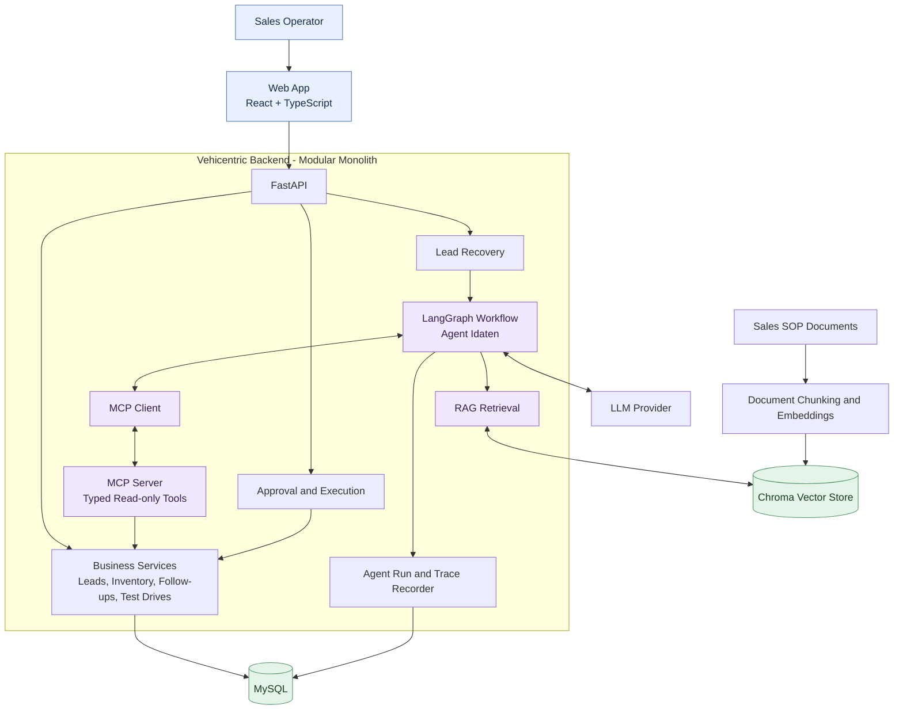
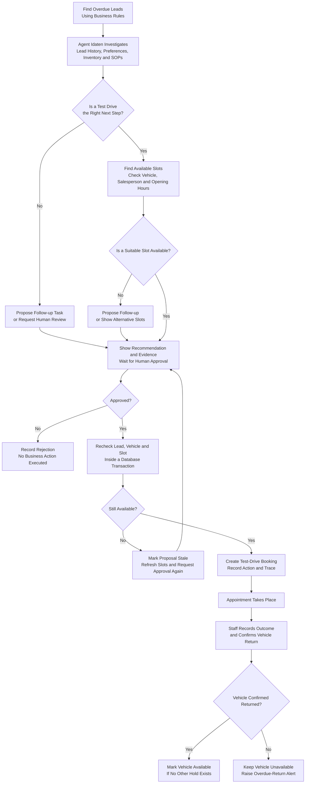
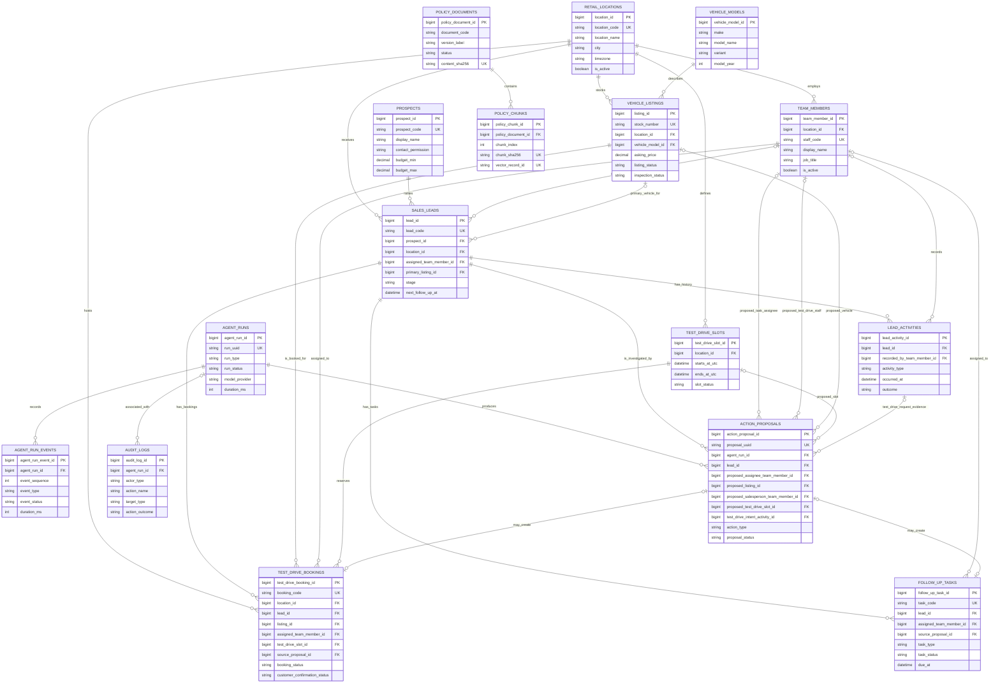

# Vehicentric

## AI-assisted lead follow-up workspace for used-car sales.

**Tagline:** Recover missed leads. Make every next step count.

Vehicentric is an internal workspace for used-car sales teams. It helps staff review overdue buyer enquiries, check vehicle and appointment details, and act on the right follow-up.

Its AI agent, **Agent Idaten**, reads the lead history, checks current business records, looks up the relevant sales procedure, and proposes one specific action:

- **Create a follow-up task** for a salesperson, such as checking whether the buyer wants to consider another vehicle.
- **Propose a test-drive booking** when the buyer has clearly asked for a test drive and a valid vehicle, salesperson, and time slot are available.

A follow-up task is an internal work item assigned to a salesperson. It does not place a call or send a message. An operator must approve an agent proposal before it changes business records. The backend checks the latest data, performs the approved action, and records what happened. Idaten does not contact customers.

This is not a public car marketplace or a full dealership management system. Demo leads, buyers, staff, listings, and bookings are generated sample data. Vehicle specifications may use cited manufacturer sources; sample listing prices and stock status are not live market data.

<!-- ## 1. Main screens

1. **Lead Recovery Dashboard:** Overdue leads, assigned salesperson, lead status, last activity, contact restrictions, pending proposals, and open tasks.
2. **Lead Review:** Buyer preferences and history, vehicle details, related sales-procedure evidence, Idaten's proposed action, and approve/reject controls.
3. **Agent Trace:** The ordered steps Idaten ran, including tool calls, records checked, procedure passages found, decisions, errors, and action results. It shows recorded steps, not hidden model reasoning.
4. **Agent Activity:** Actions and decisions that actually occurred, including approvals, task creation, bookings, cancellations, vehicle checkout/return, and recorded outcomes. Each relevant item links to its agent trace.
5. **Vehicle Inventory:** Search and filter listings, view condition and inspection status, and compare suitable alternatives.
6. **Test Drive Schedule:** Available slots, bookings, assigned salesperson, customer-confirmation record, appointment status, vehicle checkout/return, and overdue alerts. -->

The operator can check inventory and create a booking manually. Agent Idaten uses the same backend rules and records, so its results cannot bypass the rules used by the operator.

## 1. Lead Recovery workflow

1. **Lead selection:** The backend identifies open leads whose follow-up deadlines have passed, using deterministic business rules.
2. **Investigation:** Agent Idaten reviews lead history, recent activity, contact permissions, existing tasks, relevant inventory, and applicable sales procedures.
3. **Recommendation:** The agent proposes an internal follow-up task or a test-drive booking when the recorded evidence supports that action. Each proposal includes its supporting facts and procedure references.
4. **Human decision:** An operator approves or rejects the proposal. No proposed action changes business records before approval.
5. **Validation and execution:** The backend revalidates the approved proposal against current records and executes it only if all required conditions still hold.
6. **Outcome recording:** The workspace displays the action result and its associated trace. Invalid or conflicting proposals are rejected with a clear reason.
7. **Real-world status:** Staff record outcomes that cannot be established by the system alone. A created task does not prove that a call occurred, and a reserved slot does not prove customer notification or confirmation.

## 2. Test-drive booking requirements

Test-drive booking is included in the first release. A booking reserves an internal appointment slot; it does not send customer notifications or create an external calendar event.

### Eligibility and availability

- A test-drive proposal requires recorded inbound activity that clearly establishes the buyer's request. General interest in a vehicle is insufficient.
- The contact-permission status must be `permitted`. The statuses `unknown` and `do_not_contact` prevent the agent from proposing a booking.
- The vehicle must belong to the lead's location, be available, and have passed inspection. Sold, withdrawn, reserved, and review-needed vehicles are ineligible.
- The assigned salesperson must be active, eligible for test drives, and associated with the relevant location.
- The selected slot must be in the future, open, and associated with the same location.
- The demo schedule provides three sample start times per day: 10:00, 13:00, and 16:00 local time. Each appointment lasts 30 minutes, followed by a 15-minute vehicle turnaround buffer. These values are configurable demo settings.
- Availability is validated when slots are displayed and checked again during booking approval. Displayed availability does not guarantee a later reservation.
- Proposed bookings do not reserve slots. A reservation is created only after successful approval and validation. Manual bookings follow the same rules.

### Booking lifecycle and recorded outcomes

- `scheduled`: The internal appointment slot is reserved. Customer confirmation remains `not_recorded` until staff records it.
- `checked_out`: Staff has recorded that the vehicle physically left for the test drive.
- `returned`: Staff has recorded the vehicle's actual return time. The vehicle cannot be released for another test drive until its return is recorded and no other hold applies.
- `completed`: Staff has recorded the test-drive outcome, and the vehicle return has been recorded where checkout occurred.
- `cancelled`: Staff has cancelled the booking before checkout and recorded the reason.
- `no_show`: Staff has explicitly recorded a no-show after the appointment slot has ended. The system never infers a no-show from elapsed time alone.

If a checked-out vehicle passes its expected return time, the schedule displays **Return overdue**. The vehicle remains unavailable until staff records its actual return.

If an appointment slot ends without a recorded outcome, the schedule displays **Appointment outcome unresolved**. This status does not imply a no-show.

## 3. Scope

### Included in the first release

- A local operations workspace with six screens: Lead Recovery Dashboard, Lead Review, Agent Trace, Agent Activity, Vehicle Inventory, and Test Drive Schedule.
- Lead history, overdue-lead recovery, inventory search, internal follow-up tasks, and test-drive booking.
- Human approval for every action proposed by Agent Idaten.
- Trace records, activity history, and audit records for important changes.
- Sample sales-procedure documents with source and section references.
- Repeatable synthetic data and tests covering normal workflows and important failure cases.

### Excluded from the first release

- Public marketplace features, buyer accounts, self-service booking, payments, and financing.
- Outbound calls, email, SMS, WhatsApp, customer notifications, and external calendar integrations.
- Licence verification, gate passes, GPS tracking, and integration with a live dealership system.
- Multi-tenant hosting, production authentication, multiple autonomous agents, and separately deployed business microservices.
- Claims of increased sales or reduced operating costs without evidence from a measured live trial.

## 4. Architecture

Vehicentric uses a modular monolith architecture. The web application communicates with one FastAPI backend, which contains the business capabilities, agent workflow, knowledge retrieval, and audit functionality.

The backend modules share one MySQL database and run as a single application. They are logical business and technical boundaries, not separately deployed microservices.

Agent Idaten accesses business data through typed MCP tools. These tools expose approved read operations and do not provide arbitrary SQL access. Business services remain responsible for validation and data changes. The approval flow executes proposed actions only after human approval and a fresh validation of the relevant records.

Chroma supports procedure retrieval, while the authoritative procedure content and metadata remain in the application’s source documents and database. The agent trace records observable execution steps without storing hidden model reasoning.

### High-level Architecture



### Lead recovery and test-drive workflow



## 5. Repository structure
```text
vehicentric/
├── apps/
│   ├── api/
│   │   ├── pyproject.toml
│   │   ├── src/vehicentric/
│   │   │   ├── main.py
│   │   │   ├── api/            # FastAPI routes and Pydantic schemas
│   │   │   ├── leads/          # Lead records, activity, eligibility
│   │   │   ├── lead_recovery/  # Overdue queue and recovery use case
│   │   │   ├── inventory/      # Listings, readiness, alternatives
│   │   │   ├── follow_ups/     # Follow-up task rules and actions
│   │   │   ├── test_drives/    # Slots, bookings, checkout and return
│   │   │   ├── agent/          # Agent Idaten and LangGraph workflow
│   │   │   ├── mcp/            # MCP server and typed tool definitions
│   │   │   ├── knowledge/      # Procedure ingestion and retrieval
│   │   │   ├── audit/          # Activity, audit, and trace persistence
│   │   │   ├── workspace/      # Dashboard and schedule read queries
│   │   │   └── infrastructure/ # Settings, database, model adapter, logging
│   │   └── tests/
│   │       ├── unit/
│   │       ├── integration/
│   │       └── evaluation/
│   └── web/
│       └── src/                # Pages, UI components, API client
├── data/
│   ├── reference/              # Vehicle specification sources
│   └── generated/              # Repeatable sample data
├── knowledge/policies/         # Sample sales-procedure documents
├── scripts/                    # Seed data and build the procedure index
├── docs/                       # Project notes and evaluation results
└── .env
```
## 6. Database Design



| Table                                         | What it stores                                                                                     |
| --------------------------------------------- | ---------------------------------------------------------------------------------------------------|
| `retail_locations`, `team_members`            | Sample locations and sales staff. Staff records are not login accounts.                            |
| `vehicle_models`, `vehicle_listings`          | Vehicle facts and individual sample stock units.                                                   |
| `prospects`, `sales_leads`, `lead_activities` | Buyer preferences, enquiries, lead status, and recorded activity.                                  |
| `follow_up_tasks`                             | Internal work assigned to staff, with due date and status.                                         |
| `test_drive_slots`, `test_drive_bookings`     | Appointment slots, reservations, assigned staff, booking status, and customer-confirmation status. |
| `policy_documents`, `policy_chunks`           | Source procedures and sections used for retrieval and citations.                                   |
| `agent_runs`, `agent_run_events`              | Agent run status, ordered trace events, tool results, errors, timing, and usage where available.   |
| `action_proposals`                            | Proposed action, evidence, source citations, expiry, and human decision.                           |
| `audit_logs`                                  | Who approved, rejected, or changed something, when it happened, and the result.                    |

### Data integrity and storage requirements

- All event timestamps are stored in UTC. Appointment times are displayed in the associated location's time zone.
- Foreign keys and appropriate indexes support referential integrity and common query patterns.
- Related business changes are committed atomically through database transactions.
- Synthetic records are identifiable as demo data.
- MySQL is the source of truth for procedure content and metadata. Chroma stores retrieval representations and is not the authoritative source for policies.

## 7. Safety and failure handling

The system preserves data consistency and prevents unapproved or invalid actions. If validation fails, the proposed action is not executed.

### Data consistency
- Approval validates the proposal against the current lead, contact permissions, vehicle condition, availability, time slot, staff assignment, and supporting evidence.
- Repeated requests must not create duplicate tasks or bookings.
- Concurrent booking attempts must not reserve the same vehicle or time slot. Conflicting requests are rejected.
- A booking is created only when a valid vehicle, slot, and staff assignment are available.
- Related database changes are committed atomically. Failed transactions leave no partial business action.

### Test-drive lifecycle
- A vehicle remains unavailable after checkout until staff records its return.
- An overdue return raises an alert without automatically marking the vehicle as returned.
- An appointment without a recorded outcome remains unresolved. The system does not automatically classify it as a no-show.
- Missing contact permission or an unclear test-drive request prevents the corresponding action from being proposed.

### Agent and dependency failures
- Model, MCP, database, and vector search failures are recorded in the agent trace.
- Missing procedure evidence is reported as unavailable. The agent must not invent policies or citations.
- Retrieved documents and lead notes are treated as untrusted data. They cannot override tool permissions or system rules.
- Database-backed workspace views remain usable when agent-related dependencies fail.

### Auditability
- Agent traces contain concise, safe summaries of tool inputs, outputs, and execution results. They exclude secrets and hidden model reasoning.
- The activity log records an action as successful only after the database transaction commits and the result is verified.
- Failed, rejected, stale, and conflicting actions retain their outcomes for review.
